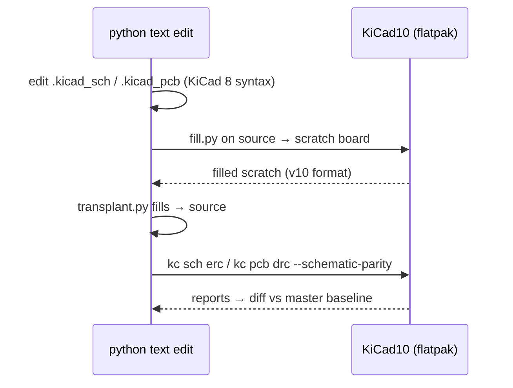

# Editing KiCad 8 files as text

The sources must stay KiCad 8 (see [../practices.md](../practices.md)). Every schematic
and PCB change on this project is a scripted s-expression text edit, checked with the
KiCad 10 `kicad-cli`.

## Helpers in `tools/`
| File | Purpose |
|---|---|
| `sexp.py` | minimal s-expr parser + `pads(board)` → absolute pad coords/nets (handles footprint rotation) |
| `render.py` | `python3 -I render.py tools pcb out.svg X0 Y0 X1 Y1` → close-up SVG of F.Cu pads/tracks/vias/fills (rasterize with `magick`) |
| `fill.py` | runs **inside the flatpak**: load board, `ZONE_FILLER.Fill`, save to a scratch path (KiCad 10 format) |
| `transplant.py` | copies `filled_polygon` blocks from the scratch board back into the KiCad 8 source, matched by zone uuid |
| `apply_tl16c550d.py` | the one-shot U7 swap edit (kept as a worked example; do not re-run on the edited tree) |
| `kc` | `kicad-cli` wrapper |

## Patterns that worked
```python
# find the block that contains a reference, then edit only inside it
k = pcb.index('(property "Reference" "Y1"')
i = pcb.rindex("\n\t(footprint ", 0, k) + 1
j = block(pcb, i)                 # paren-matching, string-aware
pcb = pcb[:i] + fix(pcb[i:j]) + pcb[j:]
```
- **Clone a footprint** (e.g. R15 → R18): regenerate every `(uuid ...)`, set `(at x y rot)`.
  Pad angles inside the footprint carry the footprint rotation, so rewrite them as well.
  Set `(path "/<sheet-uuid>/<symbol-uuid>")` to match the new schematic symbol. The
  WiFi sheet uuid is `00000000-0000-0000-0000-00005619415c` and the root is `8beda605-…`.
- **New schematic symbol**: needs `(instances (project "mega-wifi" (path "/<root>/<sheet>" (reference …) (unit 1))))`.
- **Renaming nets**: give nets explicit labels (`/WiFi/XIN`). Auto names like
  `Net-(U7-XTAL1)` change whenever a pin is renamed, and the PCB net names must match
  for `--schematic-parity`.
- **Removing a net** from the PCB net table (`(net 125 …)`) is fine. KiCad tolerates gaps
  in the numbering.
- A pad that overlaps an existing track counts as connected. R18 relies on this, so it
  needed no new segments.



## Invariants
- After editing, the PCB header still reads `(version 20240108)` and
  `(generator_version "8.0")`, and the schematic reads `(version 20231120)`.
- Zone fills come from KiCad 10's filler. They differ from KiCad 8 fills by a few tiny
  islands, which DRC accepts. Upstream KiCad 8 will refill them the same way on its next save.
- Pixel-diff the exported layer SVGs against master after a copper edit to confirm the
  change stayed local (`magick compare -metric AE`).
