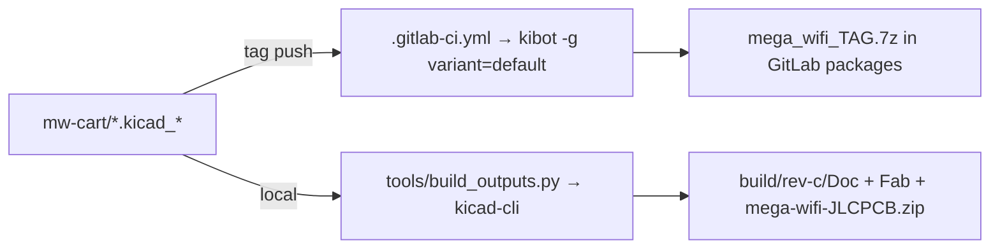

# Build & outputs

## Two output pipelines
| Pipeline | Where it runs | Produces | Used for |
|---|---|---|---|
| Upstream KiBot CI | GitLab, `ghcr.io/inti-cmnb/kicad8_auto`, tags only | full `Kibot/` tree → 7z → package registry | the top-level `Browse/ Doc/ Fab/` here (tag Rev.B) |
| Local kicad-cli | Linux or macOS, any KiCad 10 install | `build/<branch>/Doc,Fab` subset | release assets such as `build/rev-c/` |



## Local toolchain (Linux or macOS, never Windows)
`build_outputs.py`, `tools/kc` (kicad-cli) and `tools/kipy` (Python with `pcbnew`) find KiCad
in the same order, so one command works everywhere:

| Order | kicad-cli | 3D library default (`KICAD8_3DMODEL_DIR`) |
|---|---|---|
| 1 | `$KICAD_CLI` | — |
| 2 | `kicad-cli` on PATH (Arch/Omarchy `pacman -S kicad kicad-library-3d`, Homebrew) | `/usr/share/kicad/3dmodels`, or the `.app`'s `SharedSupport/3dmodels` if PATH points into KiCad.app |
| 3 | `/Applications/KiCad/KiCad.app/Contents/MacOS/kicad-cli` | `KiCad.app/Contents/SharedSupport/3dmodels` |
| 4 | flatpak `org.kicad.KiCad` | `/app/extensions/Library/3dmodels` |

`KICAD8_3RD_PARTY` defaults to `tools/ext/3rdparty`, which `tools/fetch-ext.sh` creates: a sparse
Espressif clone pinned at `dd76561`, linked as `3dmodels/com_github_espressif_kicad-libraries`
to match the path stored in the PCB. If the 3D library directory is missing, STEP and renders are skipped.

```bash
cd mw-cart                     # repo root
tools/fetch-ext.sh             # once
python3 -I tools/build_outputs.py . ../build/rev-c   # wipes the output dir first
```

**Cross-platform parity (verified 2026-10-28):** the macOS build (KiCad.app 10.0.6) of the
`rev-c-1` sources matches the Fedora flatpak build (10.0.6) that the release assets came from.
The file list, JLC BOM/CPL and generic BOM/positions are byte-identical, the Gerbers and drills
are identical apart from date lines, and the STEP is the same size and includes the ESP32 model.

## What `build_outputs.py` makes (mirrors KiBot names)
- `Doc/Schematic/mega-wifi-schematic.pdf`, `Doc/Export/{netlist.net, IPC-D-356.d356}`
- `Doc/PCB/PDF/mega-wifi-<layer>.pdf` + `-assembly.pdf`, `Doc/PCB/2D_render/*.png`,
  `Doc/3D/mega-wifi-3D.step`, `Doc/3D/mega-wifi-3D_top30deg.png`
- `Fab/Gerbers/` (KiCad extensions, combined drill + PDF map + job file),
  `Fab/Position/both_pos.{csv,pos}`, `Fab/BoM/Generic/mega-wifi-bom.csv`
- `Fab/Manufacturers/JLCPCB/`: Protel-extension gerbers, separate PTH/NPTH drills with
  gerber maps, `mega-wifi_bom_jlc.csv`, `mega-wifi_cpl_jlc.csv`, all zipped to
  `Fab/Manufacturers/mega-wifi-JLCPCB.zip`.

Not produced: `Browse/` HTML, interactive HTML BOM, positional/xlsx BOMs, boardview `.brd`,
VRML, and the PCBWay/Elecrow/FusionPCB packs. Those need KiBot itself.

## Full KiBot output
The local pipeline doesn't run KiBot. Upstream's image `ghcr.io/inti-cmnb/kicad8_auto` is amd64 only:
it should run under Docker or Podman on an x86_64 Linux box, and only under emulation on Apple
silicon (untested both ways). The upstream config's slow or blocking outputs are `basic_info`
(hangs in `kibot-check`), `basic_pcb_print_pdf` (drives the GUI) and the `pcbdraw` PNGs (RAM
heavy); skip them with `-i`. The surest full tree is still a tag on a GitLab fork, so upstream CI runs.

## JLC CPL contract
- Coordinates are relative to the aux origin `(104.14, 130.175)`, with Y flipped (the pos
  file uses `--use-drill-file-origin`).
- Rotation fixes copied from KiBot's JLCPCB filter, as seen in the Rev.B CPL:
  `^SOT-223 +180`, `^SOT-23 +180`, `^TSSOP- −90`, then normalized to 0–360. Everything
  else passes through, including U7 at 180° and R18 at 0°.
- Rows are limited to parts that have an `LCSC#` (so P1, the mounting holes and TP1 drop out).
- Regression check: diff against the Rev.B CPL. The only differences should be U7, Y1 and R18.

## Lessons
- KiCad 10 `pcb render`/`step` resolve `${KICAD8_3DMODEL_DIR}` only when it's set explicitly.
  KiCad 10 only predefines `KICAD10_*`, which is why `build_outputs.py` always sets the KICAD8 names.
- The `.wrl` paths in the PCB still render; `step --subst-models` swaps in `.step` files.

Related: [kicad-text-editing.md](kicad-text-editing.md), [../practices.md](../practices.md).
