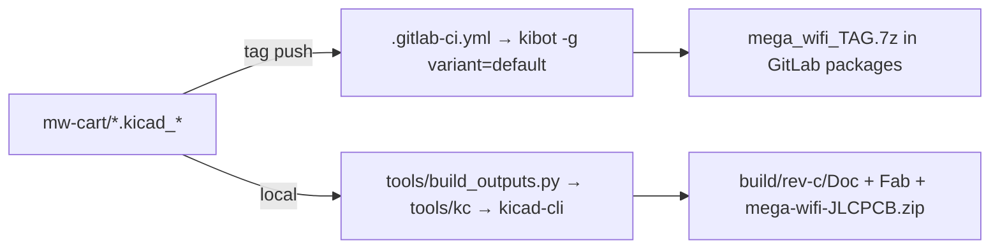

# Build & outputs

## Two output pipelines
| Pipeline | Where it runs | Produces | Used for |
|---|---|---|---|
| Upstream KiBot CI | GitLab, `ghcr.io/inti-cmnb/kicad8_auto`, tags only | full `Kibot/` tree → 7z → package registry | the top-level `Browse/ Doc/ Fab/` here (tag Rev.B) |
| Local kicad-cli | this machine, KiCad 10 flatpak | `build/<branch>/Doc,Fab` subset | branch builds such as `build/rev-c/` |



## Local toolchain (this ARM Fedora/Asahi box)
- `flatpak install --user flathub org.kicad.KiCad`: KiCad 10.0.6, with the Footprints and
  Packages3D extensions (3D models at `/app/extensions/Library/3dmodels` inside the sandbox).
- `tools/kc`: wrapper that runs `kicad-cli` in the flatpak with `/tmp` and `~/Desktop` mounted.
- The Espressif ESP32 3D model comes from a sparse clone in `tools/ext/espressif-kicad`.
  It is exposed as `tools/ext/3rdparty/3dmodels/com_github_espressif_kicad-libraries` to
  match the `${KICAD8_3RD_PARTY}` path stored in the PCB.
- Podman can't run the KiBot image here: no `/etc/subuid` range for the domain user, and
  the image is amd64 only.

```bash
cd mw-cart                     # repo root
tools/fetch-ext.sh             # once: Espressif 3D models, pinned dd76561
KICAD8_3DMODEL_DIR=/app/extensions/Library/3dmodels \
KICAD8_3RD_PARTY=$PWD/tools/ext/3rdparty \
python3 -I tools/build_outputs.py . ../build/rev-c
```

## What `build_outputs.py` makes (mirrors KiBot names)
- `Doc/Schematic/mega-wifi-schematic.pdf`, `Doc/Export/{netlist.net, IPC-D-356.d356}`
- `Doc/PCB/PDF/mega-wifi-<layer>.pdf` + `-assembly.pdf`, `Doc/PCB/2D_render/*.png`,
  `Doc/3D/mega-wifi-3D.step`, `Doc/3D/mega-wifi-3D_top30deg.png`
- `Fab/Gerbers/` (KiCad extensions, combined drill + PDF map + job file),
  `Fab/Position/both_pos.{csv,pos}`, `Fab/BoM/Generic/mega-wifi-bom.csv`
- `Fab/Manufacturers/JLCPCB/`: Protel-extension gerbers, separate PTH/NPTH drills with
  gerber maps, `mega-wifi_bom_jlc.csv`, `mega-wifi_cpl_jlc.csv`, all zipped to
  `Fab/Manufacturers/mega-wifi-JLCPCB.zip`.

Not produced: `Browse/` HTML, interactive HTML BOM, positional/xlsx BOMs, boardview `.brd`,
VRML, and the PCBWay/Elecrow/FusionPCB packs. Those need KiBot itself.

## Running KiBot locally (partially working)
KiBot 1.9.1 runs inside the KiCad flatpak's Python 3.14. The upstream config generates
the BOMs, gerbers, drills, JLCPCB/Elecrow/PCBWay/FusionPCB packs and netlists, but three
outputs block a full run:
- `basic_info` hangs in `kibot-check`. Skip it with `-i basic_info`.
- `basic_pcb_print_pdf` (`pcb_print`) hangs because it drives the KiCad GUI. Skip it.
- The `pcbdraw` PNG outputs exhausted RAM through the `tools/hostbin/rsvg-convert` shim
  (ImageMagick). The run was killed by Claude Code's low-memory reaper. Install real
  `librsvg2-tools` on the host, or skip `basic_pcbdraw_png_*`.

```bash
# one-time: pip install into a target dir (not byte-compiled), expose host gs/magick
flatpak run --command=sh org.kicad.KiCad -c "python3 -m pip install --target $KPY kibot InteractiveHtmlBom kiauto"
find $KPY/kibot -name __pycache__ -exec rm -rf {} + ; cp $KPY/bin/kibot-check $KPY/kibot/
# run (in a scratch copy of the project, never in mw-cart/)
flatpak run --filesystem=host-os --filesystem=$HOME/Desktop --filesystem=$KPY \
  --env=PYTHONDONTWRITEBYTECODE=1 --env=KICAD8_3DMODEL_DIR=/app/extensions/Library/3dmodels \
  --env=KICAD8_3RD_PARTY=$W/tools/ext/3rdparty --command=sh org.kicad.KiCad -c \
  "PYTHONPATH=$KPY PATH=$W/tools/hostbin:$KPY/bin:\$PATH python3 -m kibot -c mega_wifi.kibot.yaml \
   -g variant=default -i basic_info basic_pcb_print_pdf"
```
`tools/hostbin/` holds shims that run host `gs`/`magick`/`convert`/`identify` through
`/run/host/lib/ld-linux-aarch64.so.1 --library-path /run/host/usr/lib64` (needs
`--filesystem=host-os`). The KiBot install lived in the session scratchpad and is gone,
so reinstall it to use it. The surest way to get the full upstream tree is still a tag
on a GitLab fork, so the upstream CI runs.

## JLC CPL contract
- Coordinates are relative to the aux origin `(104.14, 130.175)`, with Y flipped (the pos
  file uses `--use-drill-file-origin`).
- Rotation fixes copied from KiBot's JLCPCB filter, as seen in the Rev.B CPL:
  `^SOT-223 +180`, `^SOT-23 +180`, `^TSSOP- −90`, then normalized to 0–360. Everything
  else passes through, including U7 at 180° and R18 at 0°.
- Rows are limited to parts that have an `LCSC#` (so P1, the mounting holes and TP1 drop out).
- Regression check: diff against the Rev.B CPL. The only differences should be U7, Y1 and R18.

## Lessons
- KiCad 10 `pcb render`/`step` resolve `${KICAD8_3DMODEL_DIR}` only when it's passed in
  explicitly (`flatpak --env=`).
- The `.wrl` paths in the PCB still render; `step --subst-models` swaps in `.step` files.

Related: [kicad-text-editing.md](kicad-text-editing.md), [../practices.md](../practices.md).
