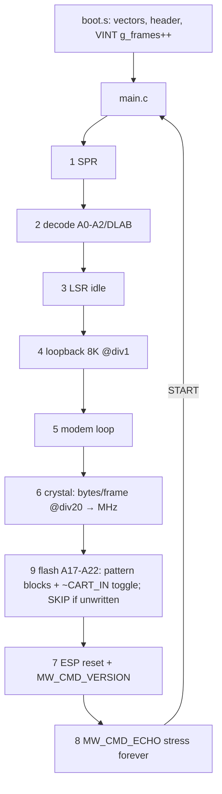

# Rev.C bring-up ROM (`bringup-rom/`)

A standalone 68000 ROM (no SGDK) that validates an assembled Rev.C board: U7
TL16C550D, the 20 MHz Y1/R18 oscillator, the 1.25 Mbaud ESP32 link, and (test 9)
flash address lines A17–A22 including the flat-8 MiB `~CART_IN` = A22 hack. It is a
directory of the mw-cart repo (`bringup-rom/`). The built `.bin` is a release asset, not in git. Its README
is the user-facing doc.



## Contracts
- UART at `0xA130C1 + 2*reg`. Constants are in `uart.h` (`UART_CLK_HZ 20000000`, divisor 1).
- ESP32 reset sequence (from SGDK `uart_init`/`uart_start`): `MCR=AFE|DTR` (EN low,
  RTS clear → GPIO9 high), wait 3 frames, `MCR=AFE`, wait 60 frames, reset FIFOs (drops
  the ESP ROM's 115200 chatter), then `MCR=AFE|RTS`.
  **Never set RTS while EN is released**: GPIO9 low at boot means download mode.
- LSD frame: `7E | ch<<4|lenH | lenL | payload | 7E`. MW command = `cmd16 BE | len16 BE | data`.
  The reply to VERSION is `00 00 | len | maj min mic variant\0`. ECHO returns the header
  `00 00 len` plus the same data. The firmware caps payloads at TCP MSS, so the ROM uses ≤1024 bytes.
- Crystal measurement: loopback at divisor 20, TX FIFO refilled on THRE (no line gaps),
  bytes counted over 120 frames, NTSC 59.92 / PAL 49.70 fps:
  ```c
  bps100 = bytes * fps100 / frames;            // < 1e6, fits 32-bit
  khz    = bps100 * (16UL * 10 * div) / 100000UL;
  ```
- Test 9 pattern (shared contract between `tools/fk_hiflash.py` `pattern()` and `main.c` `hb_*`):
  13 blocks of 128 words at `$020000 $040000 $080000 $100000 $200000 $3E0000` (A17–A21) and
  `$400000 $420000 $440000 $480000 $500000 $600000 $7E0000` (A22 + hack). Each block is:
  ```c
  { 0x4D57, 0x4154, a >> 16, a & 0xFFFF, ~(a >> 16), ~a & 0xFFFF, /* "MWAT", addr, ~addr */
    lfsr... }  /* 122 words: s = 0xACE1 ^ (a >> 8) (0 -> 1); s = (s >> 1) ^ (s & 1 ? 0xB400 : 0) */
  ```
  A block whose header carries another address is an alias. The lowest differing bit names
  the address line, and A22 points at R1 / `~CART_IN`. No `MWAT` anywhere means SKIP, because the
  pattern was never written; a cart with another ROM in it must not FAIL. If the low half is OK
  and the high half is blank, the 8 MiB map is missing (R2 fitted, or a console/emulator without it).
  The toggle phase reads `$000100` ("SE") and each high block's first LFSR word back to back for
  300 frames. Test 9 does not feed `hw_ok` ("UART + crystal OK").
- `fk_hiflash.py write|verify|erase` uses the FlashKit protocol (`Device.cs`): 64 KiB erase =
  8 sector commands at 8 KiB stride, unlock-bypass programming. Before erasing it requires CFI
  QRY, an 8 MiB chip, and each target 64 KiB block holding only 0xFF or our own pattern
  (`--force` overrides). It never touches `$000000`–`$01FFFF`. `image ROM OUT` builds the 8 MiB image offline.
- Every hardware wait is bounded by a frame timeout. A dead bus reads 0xFF (DR stuck
  high), so drain loops have byte caps and `lsd_recv` has an absolute deadline.

## Toolchain invariants (each was a real crash)
- Fedora `gcc-m68k-linux-gnu` is Linux-targeted (68020 default):
  - Its **libgcc is 68020+** (`__umodsi3` uses `bsr.l` = `0x61FF`, which a 68000 decodes as a branch to an odd address). Don't link it. `lib68k.c` supplies `__mulsi3/__udivsi3/__umodsi3/__divsi3/__modsi3`. Avoid 64-bit math.
  - It defaults to **`-mno-strict-align`**, so GCC merged byte stores into `move.l` on odd
    addresses. Always build with `-mstrict-align`.
- `make check` greps the disassembly for `6xFF` long branches and 32-bit mul/div/bitfield
  opcodes. Note that objdump in 68000 mode shows `0x61FF` as `bsrs`, so match on the hex.

## Flashing
The user's programmer is FlashKit MD, driven by their own `flashkit-md-dotnet` (≥ v1.10.5). It has per-OS
binaries in that repo's `artifacts/<rid>/` (`osx-arm64`, `linux-x64`, …), plus a flatpak `io.github.jfryman.FlashKitMD`.
Back up first, then flash:
```sh
flashkit-md read-rom --trust-header backup.bin
flashkit-md write-rom bringup-rom/mw-revc-bringup.bin
```
Don't use `--full-erase`: it assumes a 4 MB chip, and the cart's S29GL064N is 8 MB. Don't
use `--no-flash-check`: the S29GL064N supports CFI, so a failed check means a real problem.
The ROM also runs on a Rev.B cart as a real-hardware check of the ROM itself. Expect tests
1–5 PASS, test 6 FAIL at ~24.00 MHz, and tests 7–8 PASS (24 MHz/16 = 1.5 Mbaud = stock firmware).

## Build (Linux or macOS)
`bringup-rom/container.sh <cmd>` runs any command in the Fedora 42 image built from `bringup-rom/Containerfile`
(`gcc-m68k-linux-gnu`, MAME 0.287; tag `mw-bringup-rom:fedora42`). It prefers podman (`:Z`,
`--userns=keep-id`) and falls back to docker (`--user uid:gid`), so build products stay user-owned. It
sets the headless SDL env MAME needs and forwards `SIM_*`. Native `make` works only on Fedora.
**Release builds must be `make clean && make`.** `rev-c-1`'s ROM (`EC8415F0`) was linked with
stale `boot/vdp/font/lib68k.o` from the Fedora box's older gcc. A clean gcc 15.2.1 build of the
same source is `00DFED58`; it behaves the same in the sim (all paths), but isn't the build bench-tested on board 1. GCC 15 flags constant pointers below 4 KiB as null (`-Warray-bounds`), so
`main.c` passes `$000100` through an empty `asm` to hide the constant.

## Simulation
`sim/uart_model.lua` (MAME autoboot script) models the UART and a fake ESP32 through
memory taps on `$A130C0-$A130CF`. `sim/run.sh [none|noesp|corrupt] [snap seconds]`.
Verified results on 2026-10-06: all PASS at 20.01 MHz, 0 echo errors; `noesp` gives
test 7 FAIL with the firmware hint; `corrupt` counts mismatches.

Test 9 in the sim: `SIM_CART` = an 8 MiB image from `fk_hiflash.py image`, and `SIM_HI` = an
image served at `$400000+` through a read tap. MAME 0.287 maps a plain cart below 4 MiB only, but
taps above it do fire. Verified 2026-10-28 with five cases: plain ROM → SKIP; no `SIM_HI` → FAIL
"R2? no 8MiB map"; pass → `L6 H7`, ~716k toggle reads, 0 errors; an A19 alias → "A19 open?"; and a
high half mirroring the low half → "A22 (R1/~CIN)". MAME repeats a 128 KiB image across the
cart space, which is why SKIP keys on the `MWAT` marker and not on 0xFF.
**Lesson:** zsh doesn't word-split `$var`, so `extra="-e X=1"; docker run $extra` passes one bad arg.

**Lesson:** Fedora's `/etc/mame/mame.ini` has `autosave 1`. Without `-noautosave`, MAME
restores the last machine state, so every later run silently replays an old crash.

The sim validates ROM logic only. The CS-hold timing risk
([../hardware/uart-bridge.md](../hardware/uart-bridge.md)) can only show up on real boards,
as test-8 mismatches.

Related: [uart-baud-coupling.md](uart-baud-coupling.md), [../plans/rev-c.md](../plans/rev-c.md).
