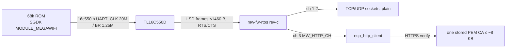

# MegaWiFi API on Rev.C (what a game ROM can use)

What a ROM can rely on when it talks to the ESP32 through U7. Checked 2026-10-28 against
`mw-fw-rtos` `rev-c` and SGDK master (`inc/ext/mw/`, API v1.5).

## Contracts
- SGDK `inc/config.h`: `MODULE_MEGAWIFI 1` and `MEGAWIFI_IMPLEMENTATION` =
  `MEGAWIFI_IMPLEMENTATION_MW_CART`. Master defaults to CROSS|ED, which needs `MODULE_SERIAL` /
  bank switching and doesn't drive this cart. `16c550.h` needs `UART_CLK 20000000LU`, `UART_BR
  1250000LU`, and then a rebuilt `libmd.a` ([uart-baud-coupling.md](uart-baud-coupling.md)).
- Structure: `mw_init(buf, ~1.5 KB)`, then `TSK_userSet()` with a task looping `mw_process()`. SGDK
  yields to it inside `SYS_doVBlankProcess()` / `VDP_waitVSync()`. `mw_*` calls block the
  supervisor task until reply or timeout (`MW_MS_TO_FRAMES`); the async path is `mw_send` / `mw_recv`.
- Limits (firmware): `MW_MAX_SOCK 2`, `LSD_MAX_CH 4` (ch 0 = commands, 3 = HTTP), `LSD_MAX_LEN
  1460` (`CONFIG_TCP_MSS`). An HTTP body streams on `MW_HTTP_CH` after `mw_http_finish()` returns
  `content_len`.
- **HTTPS:** `main/http.c` sets only `.cert_pem` from the cert partition (`MW_CERT_MAXLEN` = 8 KiB − 8).
  There's no `crt_bundle_attach`, and `CONFIG_ESP_TLS_INSECURE` is off, so with no stored cert HTTPS
  verification most likely fails (not yet tried on hardware). The bundle is compiled in
  (`CONFIG_MBEDTLS_CERTIFICATE_BUNDLE=y`), so attaching it in the fork is a small change.
- Storage: ~2 MiB ESP32 user flash in 4 KiB sectors (`mw_flash_*`), and 3 Wi-Fi config slots in NV.
  Fresh Rev.C boards have no AP configured, and stock wflash needs the 20 MHz `16c550.h` too.

## Data-size lesson (ADS-B, 2026-10-28)
A 25 nm adsb.fi / adsb.lol query around KORD returned 36–40 KB of JSON (72–74 aircraft, ~600 B each).
That's too much for 64 KiB of 68k RAM plus jsmn tokens, so filter and pack it to binary in a relay or in the firmware.
The ATC radar ROM project brief is in the workspace: `~/Desktop/mega_wifi/atc-radar-prompt.md`.

Related: [uart-baud-coupling.md](uart-baud-coupling.md), [bringup-rom.md](bringup-rom.md).
