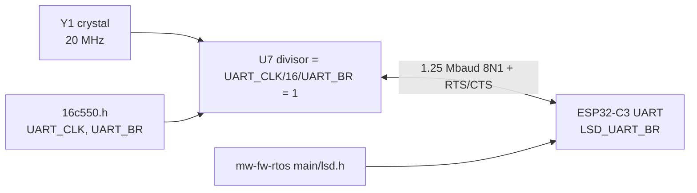

# UART clock ↔ firmware coupling

The baud rate is set at **compile time on both ends** of the link. The 68k computes the
16550 divisor from `UART_CLK`/`UART_BR`, and the ESP32 opens its UART at `LSD_UART_BR`.
Both ends must agree. Upstream assumes a 24 MHz crystal and 1.5 Mbaud, while branch
`rev-c` hardware runs a 20 MHz crystal at 1.25 Mbaud.



## Where the constants live (upstream values)
| Repo | File | Constant | Upstream | This board |
|---|---|---|---|---|
| SGDK | `inc/ext/mw/16c550.h` | `UART_CLK` / `UART_BR` | 24000000 / 1500000 | 20000000 / 1250000 |
| mw-api | `mw/16c550.h` | same | same | same change |
| mw-wflash | `src/mw/16c550.h` | same | same | same change (if using the wireless loader) |
| mw-fw-rtos | `main/lsd.h` | `LSD_UART_BR` | 1500000 | 1250000 |

```c
// SGDK inc/ext/mw/16c550.h — this board
#define UART_CLK   20000000LU
#define UART_BR    1250000LU   // divisor 1: DLM=0, DLL=1
```
```c
// mw-fw-rtos main/lsd.h — this board
#define LSD_UART_BR  1250000   // UART_SCLK_XTAL 40 MHz / 1.25M = 32, exact
```

## Invariants
- `UART_CLK / (16 * UART_BR)` must come out to an integer: 20 MHz gives 1.25M (div 1),
  625k (div 2), and so on.
- SGDK compiles `16c550.c` into `libmd.a`, so **rebuild SGDK's library** after editing
  the header. Changing a ROM's own sources is not enough.
- The ESP32 must be flashed (USB-C, P2) with matching firmware. Stock MegaWiFi firmware
  and existing ROMs (e.g. 1985 WorldCup) will **not** talk to this board.
- `rx_flow_ctrl_thresh = 122` in `lsd.c` and the 14-byte RX trigger on U7 are independent
  of the baud rate and stay as they are.

## ESP32 firmware build (mw-fw-rtos)
`mw-fw-rtos/` in the workspace is the fork **github.com/jfryman/mw-fw-rtos** (`origin`;
`upstream` = gitlab.com/doragasu/mw-fw-rtos). Branch `rev-c` (default; cut from `master` `e6a7fdd`)
sets `LSD_UART_BR` to 1250000 in commit `d6c5a45`. Release `rev-c-1250k` carries the built images. Upstream
`master` targets the **esp32c3** with ESP-IDF **v5.3.1**, per its `.gitlab-ci.yml`. The old
ESP8266 code lives on the `esp8266` branch, and the README still describes it.
The build runs in the official ESP-IDF container, the same on Linux and macOS. `P` is `docker` or
`podman` (on the old Fedora box, rootless podman needed `--storage-opt ignore_chown_errors=true`
because the AD account had no `/etc/subuid` range). `:Z` is harmless on Docker Desktop for macOS:

```bash
P=podman   # or docker
cd mw-fw-rtos
$P run --rm -v "$PWD":/project:Z -w /project docker.io/espressif/idf:v5.3.1 \
  bash -c 'idf.py set-target esp32c3 && idf.py build'
# single image for USB flashing at 0x0:
$P run --rm -v "$PWD/build":/b:Z -w /b docker.io/espressif/idf:v5.3.1 \
  bash -c 'python -m esptool --chip esp32c3 merge_bin -o mw-fw-rtos-merged.bin @flash_args'
```

Outputs go to `build/rev-c/esp32-fw/`: a CI-style tarball with the bootloader at 0x0, the
partition table at 0x8000, otadata at 0xe000 and the app at 0x10000 (DIO, 80 MHz, 4 MB),
plus `mw-fw-rtos-merged.bin`. The merged image flashes in one step:

```bash
esptool.py --chip esp32c3 -p /dev/ttyACM0 write_flash 0x0 mw-fw-rtos-merged.bin   # Linux
esptool.py --chip esp32c3 -p /dev/cu.usbmodem101 write_flash 0x0 mw-fw-rtos-merged.bin   # macOS
```

esptool comes from pip (`pip install esptool`, in a venv) on either OS. A blank ESP32-C3-WROOM-02 (as JLC fits it) boot-loops
and re-enumerates on USB every ~2.6 s, so the port keeps disappearing. esptool still catches it with
`--before usb-reset` (retry if the first open races a re-enumeration).

To check the baud rate in the binary, disassemble `LsdInit`. RISC-V builds the constant in
two instructions, so grepping for the raw bytes misses it. 1.25M shows up as
`lui a5,0x131; addi a5,a5,720` (0x1312D0).

The other firmware repos are not in this workspace. Clone them from
gitlab.com/doragasu/{mw-api,mw-wflash} and github.com/Stephane-D/SGDK as needed.

Related: [../hardware/uart-bridge.md](../hardware/uart-bridge.md).
