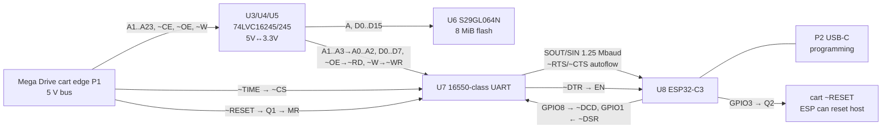

# Hardware architecture (mw-cart Rev.B → Rev.C)

The board is 83.82 × 50.95 mm, 2-layer FR4, 1.6 mm thick, with all parts on the top
side. It needs gold fingers with a 30° chamfer and ENIG finish (README fab notes). The
board runs from the cart +5V through an AMS1117-3.3 regulator (U2) to `VCC` (3.3 V).
D2 (1N5819WS) also lets USB-C VBUS power it.

Schematic sheets:
- `mega-wifi.kicad_sch` (root): cart edge P1, U1 glue, U3/U4/U5 transceivers, regulator
- `rom.kicad_sch` (`/ROM/`): U6 S29GL064N flash, word mode (`~BYTE` tied to VCC)
- `wifi.kicad_sch` (`/WiFi/`): U7 UART, Y1 crystal, U8 ESP32-C3, USB-C P2, audio and video taps

## Key nets around the UART
| Net | Connects | Notes |
|---|---|---|
| `/~{C_TIME}` | P1.B31 → U7.8 (CS) | the UART answers in $A130xx; SGDK base `0xA130C1` (odd bytes, stride 2) |
| `/A1..A3` | U3/U4 → U7.19/18/17 (A0..A2) | 68k A1..A3 select registers |
| `/D0..D7` | U5 B side ↔ U6 ↔ U7 | low data byte shared with flash |
| `/~{OE}`, `/~{W}` | U4.4, U3.38 → U7.14 (RD), U7.12 (WR) | |
| `Net-(Q1-D)` | Q1 drain + R9 10k to VCC → U7.23 (MR, active-high) | the console's ~RESET low turns Q1 off, so MR goes high and the UART holds in reset |
| `/WiFi/~{DTR}` | U7.22 → U8.2 EN | the 68k resets the ESP32 via MCR.DTR (`MW__RESET`) |
| `/WiFi/~{RTS}`,`~{CTS}` | U7.21 → GPIO9, U7.24 ← GPIO0 | hardware flow control |
| `/WiFi/~{DSR}`,`~{DCD}` | U7.25 ↔ GPIO1, U7.26 ↔ GPIO8 (R13 pull-up) | DCD carries "data request" (`MW__DCD`) |

The UART subsystem detail is in [uart-bridge.md](uart-bridge.md). The part choice is in
[uart-part-selection.md](uart-part-selection.md).

## Invariants
- U7 has its register lines on A1..A3, so register `n` is at `UART_BASE + 2n`. Any
  replacement must keep a 16550 register map.
- All logic is 3.3 V. Any part on the U7 site must take 3.0–3.6 V and have CMOS
  inputs at 0.7×VCC.
- Assembly is top-side only, so new parts must fit on F.Cu.
- R1/R2 form an either-or jumper on cart edge pin B32 (`~CART_IN`). R1 = 0 Ω to
  `/C_A22` (fitted, LCSC C21189). R2 = `NP` to GND (`dnp yes`, so it is left out of
  the JLC BOM/CPL). This is upstream's default. Never fit both, because that shorts A22 to GND.
  R1 is the **flat 8 MiB hack**. The console maps the cart at $000000–$3FFFFF when `~CART_IN` is low and
  at $400000–$7FFFFF (the Mega-CD's region) when it is high. Driving `~CART_IN` from A22 makes
  the cart answer across $000000–$7FFFFF with no mapper. The cost is that a Mega-CD is unusable. R2
  fitted instead gives a standard 4 MiB cart.
  With a Mega-CD/CDX attached: per the console's `~CART_IN`-based decoding, the CD region is always the
  half not being accessed, so the CD should go unselected (unseen), with no bus contention. **Unverified:**
  whether the CD unit decodes its own selects, and how it reacts to `~CART_IN` toggling per access.
  Bench (2026-10-28): board 1 (R1 fitted) passes bring-up test 9 on a Mega Drive + Mega-CD + 32X
  ("Tower of Power"): the cart answers at $400000–$7FFFFF, and reads alternating below/above 4 MiB
  (`~CART_IN` toggling per access) give 0 errors over ~5 s with no visible misbehaviour. The CD is
  unreachable while R1 is fitted, as the README says. Still unverified: long-term stress on CD
  hardware, other CD/CDX models, and whether the CD unit decodes its own selects (no schematic
  checked). Check: [../firmware/bringup-rom.md](../firmware/bringup-rom.md) test 9.
