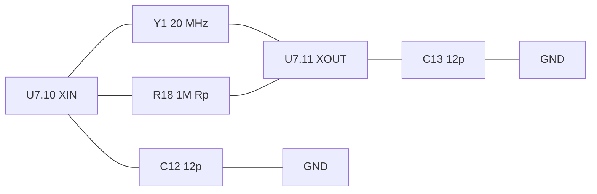
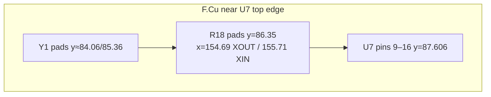

# U7 UART bridge — TL16C550DRHB (branch `rev-c`)

U7 is a single-channel 16550-class UART in a 5×5 mm 32-pin QFN. It sits at
(154.164, 90.043) on the PCB, rotated 180°. The branch fits the TI TL16C550DRHB, which
replaces the upstream NXP SC16C550BIBS. The two parts are pin-for-pin identical in this
package. Why this part was chosen is in [uart-part-selection.md](uart-part-selection.md).

## Pin map (both parts, RHB / HVQFN32)
| Pin | TI name | NXP name | Net | Difference |
|---|---|---|---|---|
| 1,3,4,5 / 29–32 | D4–D7 / D0–D3 | same | `/D0..D7` | — |
| 6 / 7 | SIN / SOUT | RX / TX | `/WiFi/RX`, `/WiFi/TX` | rename only |
| 8 | ~CS2 | ~CS | `/~{C_TIME}` | rename only |
| 9 | NC | VSS | GND | TI: no internal connection, so the GND tie is harmless |
| 10 / 11 | XIN / XOUT | XTAL1 / XTAL2 | `/WiFi/XIN`, `/WiFi/XOUT` | TI needs external Rp (R18) |
| 12 / 14 | ~WR1 / ~RD1 | ~IOW / ~IOR | `/~{W}`, `/~{OE}` | rename only |
| 17,18,19 | A2,A1,A0 | same | `/A3,/A2,/A1` | — |
| 20 | INTRPT | INT | unconnected | the MD cart edge has no IRQ line |
| 21,22,24,25,26 | ~RTS,~DTR,~CTS,~DSR,~DCD | same | `/WiFi/*` | — |
| 23 | MR | RESET | `Net-(Q1-D)` | both active-HIGH |
| 27 | ~RI | ~RI | **VCC** | NXP has internal pull-ups and TI does not, so RI is tied high |
| 28 | VCC | VDD | VCC | — |
| 33 (EP) | thermal pad | PAD | GND | TI EP 3.45 mm, NXP 3.1 mm |

## Clock: 20 MHz → 1.25 Mbaud
TI rates the RHB package to **20 MHz at 3.3 V** (24 MHz only at 5 V; the 48 MHz rating
is for the ZQS BGA). The board runs Y1 = 20 MHz (TXC 7E20000E12UCG, C252261, 12 pF load,
so the C12/C13 12 pF caps are unchanged) with divisor 1:
`20 MHz / 16 / 1 = 1.25 Mbaud`. Firmware has to match; see
[../firmware/uart-baud-coupling.md](../firmware/uart-baud-coupling.md).

TI's oscillator needs an external **1 MΩ Rp across XIN–XOUT** (datasheet Fig. 27).
NXP's datasheet shows no Rp, so its oscillator is biased internally. R18 provides Rp
(0402, C26083).



## PCB implementation
- Footprint: `Package_DFN_QFN:Texas_RHB0032E_VQFN-32-1EP_5x5mm_P0.5mm_EP3.45x3.45mm`.
  The perimeter pads are identical to the old HVQFN footprint (±2.4375 mm, 0.875×0.25),
  so no traces moved. The EP is 3.45 mm, which leaves 0.275 mm to the pin pads. The paste
  is a 3×3 grid of 0.93 mm apertures on a 1.15 mm pitch. The 3D model is
  `QFN-32-1EP_5x5mm_P0.5mm_EP3.45x3.45mm.wrl`.
- RI tie: two F.Cu 0.2032 mm segments, pad 27 (153.414, 92.481) → (153.414, 93.368) →
  the VCC track vertex at (153.914, 93.368).
- R18 sits at (155.2, 86.35), rotation 0, between Y1 and U7. Its pads land directly on the
  existing XOUT (x = 154.725) and XIN (x = 155.575) vertical tracks, so no new copper was
  needed. Its silkscreen reference is hidden for lack of room; the Fab layer still shows it.
- Accepted DRC item: R18's courtyard overlaps Y1's. The gap between the Y1 and U7
  courtyards (~0.9 mm) is smaller than an 0402 courtyard. All copper clearances are
  ≥ 0.2 mm, and the tightest is R18 pad 1 to the `/~{W}` diagonal at ~0.215 mm.



## Software contract (unchanged registers)
The driver only uses standard 16550 registers plus `MCR = 0x22` (AFE + RTS), and the
TL16C550D supports exactly this:

```c
UART_LCR = 0x83;            // DLAB=1, 8N1
UART_DLM = UART_DLM_VAL;    // 0 with 20 MHz / 1.25 Mbaud
UART_DLL = UART_DLL_VAL;    // 1
uart_set(LCR, 0x03);
uart_set(MCR, 0x22);        // auto RTS/CTS (MCR[5] AFE + MCR[1] RTS)
UART_FCR = 0xC1;            // FIFO on, RX trigger 14
```

## Pinout verification
TI's RHB **package drawing** (datasheet p.2) matches the table above for all 32 pins.
The RHB *terminal-function table* lists INTRPT 30, DSR 39, DTR 33 and MR 35, but those are
typos copied from the 48-pin PT package. Trust the drawing.

## Bus timing vs NXP at 3.3 V (pre-order paper check)
| Parameter | SC16C550B @3.3 V | TL16C550D | 68k/MD reality |
|---|---|---|---|
| RD / WR strobe width min | 26 / 20 ns | 40 / 40 ns | ~250 ns+ (7.67 MHz, no wait states): OK |
| RD↓ → data valid max | 26 ns | 45 ns | data sampled ~250 ns after strobe: OK |
| data setup / hold to WR↑ | 20 / 5 ns | 15 / 5 ns | OK |
| address hold after RD↑ | 5 ns | 20 ns | 68000 holds address ≥ ~30 ns after AS↑; probably OK |
| **CS hold after RD↑/WR↑** | **0 ns** | **10 ns** | ~TIME and ~OE/~W both come from /AS in the console, so the skew is unknown. Board 1 passes ≥1k echo-stress frames with 0 errors; margin unmeasured. |
| reset pulse min | 40 ns | 1 µs | console ~RESET is ms-long: OK |

The CS-hold item is the one that can't be closed on paper. If ~TIME rises before or with
~OE, a read of RHR may not advance the RX FIFO, or a write may latch on the CS edge. It is
most likely benign (the internal strobe is CS·RD), but it needs a bench test: a
scope/LA on ~TIME vs ~OE and ~W at U7, plus an RX-FIFO stress test.

## Emulation is not a validation path
BlastEm's `megawifi.c` (MegaWiFi emulation) handles only THR/RHR (reg 0), LSR (reg 5,
canned `0x60|rx`) and SPR (reg 7). Writes to LCR/DLL/DLM/MCR/FCR print "Unhandled" and
are ignored. It can't tell 20 MHz from 24 MHz or TI from NXP. Use it to develop ROM logic
against the LSD protocol, not to validate hardware.

## Lessons
- "Pin-compatible" second sources still differ in **internal pull-ups and oscillator
  bias**. Diff the NXP and TI datasheets on those two points for any 16550 swap.
- The NXP datasheet footnote "[2] This pin has a pull-up resistor" is why upstream left
  RI floating.
