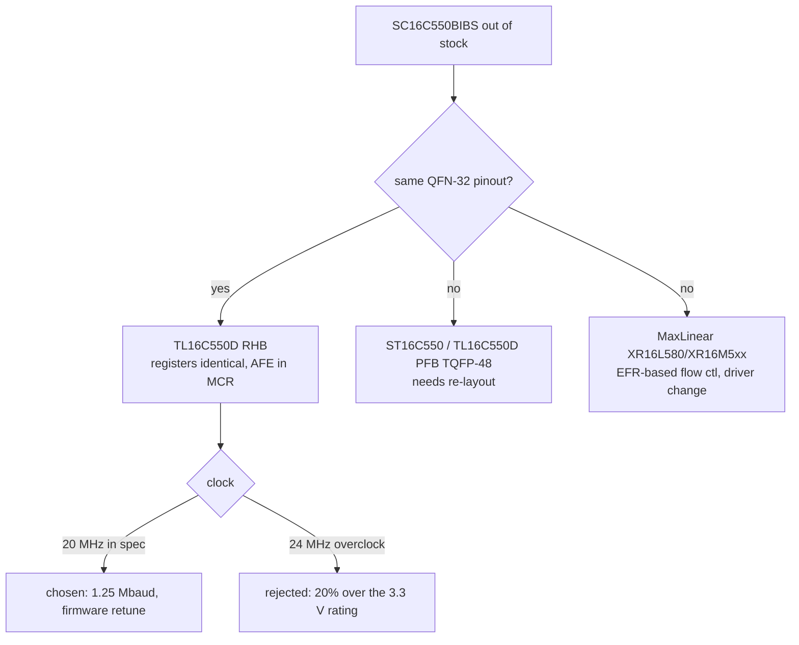

# U7 replacement part selection

The original part, NXP **SC16C550BIBS** (C3310482 / C2653253), has zero stock at JLCPCB
and across distributors (checked 2026-10-05). Requirements for a replacement:
16550 register map with MCR-AFE auto RTS/CTS (SGDK driver), 3.3 V operation, a parallel
bus, ideally the same 5×5 QFN-32 land pattern, and JLC assemblable.

## Decision: TI TL16C550DRHB (VQFN-32 RHB)
| Field | Value |
|---|---|
| BOM `manf#` | TL16C550DRHBR (0–70 °C, T&R) |
| BOM `LCSC#` | C2653239 (JLC stock 10 on 2026-10-05); C1523590 = TL16C550DRHB tube, also 10 |
| Industrial alt | TL16C550DIRHBR, C2653213 (JLC stock 0; buy via Global Sourcing / DigiKey / Mouser) |
| TI status | Active, production |
| Datasheet | https://www.ti.com/lit/ds/symlink/tl16c550d.pdf (SLLS597) |
| Max clock @3.3 V | 20 MHz (RHB/PT/PFB); this caps the link at 1.25 Mbaud |

The user approved 20 MHz / 1.25 Mbaud on 2026-10-05 because the board is for new ROMs.
Losing compatibility with existing MegaWiFi ROMs and firmware is accepted.



## Candidates rejected
- **SC16C650BIBS / SC16C750BIBS** (NXP, same package family): no stock anywhere.
- **TL16C550D PT/PFB (48-pin 7×7)**, **ST16C550IQ48**: stocked in single digits, and
  the larger footprint would force a re-layout.
- **MaxLinear XR16L580IL / XR16M5xx**: auto flow control sits in EFR (at LCR=0xBF)
  rather than MCR, and the pinout differs.
- **SPI/I²C UARTs (SC16IS7xx, MAX3100)**: the 68k bus is parallel, and the cart edge has
  no spare logic to bridge to them.

## How stock was checked (repeatable)
```bash
curl -s -X POST 'https://jlcpcb.com/api/overseas-pcb-order/v1/shoppingCart/smtGood/selectSmtComponentList' \
  -H 'Content-Type: application/json' -H 'User-Agent: Mozilla/5.0' \
  -d '{"keyword":"TL16C550","currentPage":1,"pageSize":50}' | python3 -c '
import json,sys
for c in json.load(sys.stdin)["data"]["componentPageInfo"]["list"] or []:
    print(c["componentCode"], c["componentModelEn"], c["componentSpecificationEn"], c["stockCount"])'
```
`jlcsearch.tscircuit.com` only indexes in-stock JLC parts and its fuzzy search is weak,
so prefer the JLC endpoint above.

Related: [uart-bridge.md](uart-bridge.md), [../plans/rev-c.md](../plans/rev-c.md).
