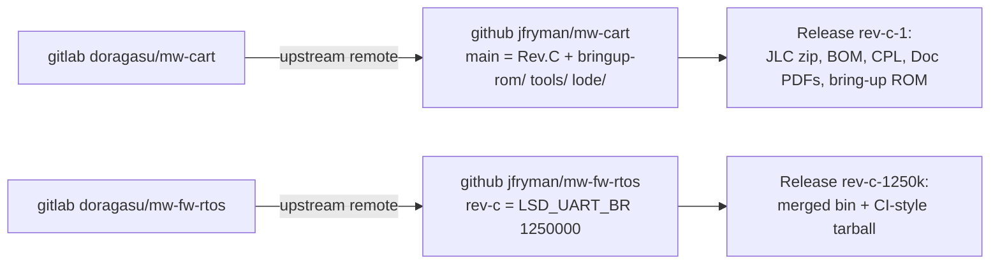

# Plan: publish Rev.C to GitHub

Decided 2026-10-28 (user): **fork layout, public, release assets for JLC files, docs PDFs,
bring-up ROM and ESP32 firmware.** Rejected: a wrapper repo with submodules (three repos,
submodule friction, and hardware users expect a fork of mw-cart).

## Repo contents
| Workspace item | Destination |
|---|---|
| `mw-cart/` KiCad sources (branch `rev-c`) | `jfryman/mw-cart` `main`; upstream `master` pushed as `upstream-master`; upstream tags kept |
| `bringup-rom/`, `tools/` (scripts + `hostbin/`), `lode/` | moved into `mw-cart/`; symlinks left at the workspace root so old paths keep working |
| `tools/ext/` (313 MB Espressif sparse clone) | git-ignored; recreated by `tools/fetch-ext.sh` (pinned commit `dd76561`) |
| `mw-fw-rtos/` branch `rev-c` | `lsd.h` change committed; `jfryman/mw-fw-rtos` default branch `rev-c` |
| `build/rev-c/` | not in git; attached to the releases |
| `Browse/ Doc/ Fab/`, `index.html`, `mega-wifi-*.txt` | stay local (upstream Rev.B KiBot output, re-downloadable) |

## Invariants
- Remotes: `origin` = GitHub (jfryman), `upstream` = GitLab (doragasu) in both clones.
- Release assets must come from the tagged sources. The KiCad files on `main` are unchanged since
  `0f4f06a`, which `build/rev-c/` was generated from.
- CERN OHL 1.2 §4: the modified docs must carry a notice of the change and its date. The title blocks
  already do; the README gets a Rev.C section. GPLv3 (firmware): the binary release sits next to the
  commit that built it.
- Git-ignored: `lode/tmp/`, `.history/`, `~*.lck`, `tools/ext/`, bring-up build artefacts, `.DS_Store`.

Related: [rev-c.md](rev-c.md), [../build/summary.md](../build/summary.md).
