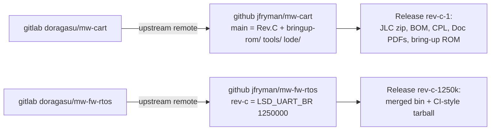

# GitHub repos and releases

Rev.C is published as two **public** forks (decided and set up 2026-10-28). Release assets cover the JLC files,
docs PDFs, the bring-up ROM and the ESP32 firmware. Rejected: a wrapper repo with submodules (three repos,
submodule friction, and hardware users expect a fork of mw-cart).

## Repo contents
| Workspace item | Where it lives |
|---|---|
| KiCad sources | `jfryman/mw-cart` `main` (default; the old local `rev-c`). Upstream `master` is on GitHub as `upstream-master`, with tags `Rev.A2`/`Rev.B` |
| `bringup-rom/`, `tools/` (scripts + `hostbin/`), `lode/` | moved into `mw-cart/`; symlinks left at the workspace root so old paths keep working |
| `tools/ext/` (313 MB Espressif sparse clone) | git-ignored; recreated by `tools/fetch-ext.sh` (pinned commit `dd76561`) |
| `mw-fw-rtos/` | `jfryman/mw-fw-rtos` `rev-c` (default): `d6c5a45` (1.25 Mbaud) + README note `0ac572e` |
| `build/rev-c/` | not in git; attached to the releases |
| `Browse/ Doc/ Fab/`, `index.html`, `mega-wifi-*.txt` | stay local (upstream Rev.B KiBot output, re-downloadable) |

## Releases
| Repo | Tag | Assets |
|---|---|---|
| mw-cart | `rev-c-1` (`938222c`) | `mega-wifi-revc-JLCPCB-gerbers.zip`, `_bom_jlc.csv`, `_cpl_jlc.csv`, schematic + assembly PDFs, `mega-wifi-revc-docs.zip` (all of `build/rev-c/Doc` + generic Fab), `mw-revc-bringup.bin` (EC8415F0), `SHA256SUMS` |
| mw-fw-rtos | `rev-c-1250k` | `mw-fw-rtos-merged.bin`, `mw_fw_rtos_esp32c3-rev-c-1250k.tar.xz` (SHA-256 in the notes) |

To cut the next hardware release: rebuild with `tools/build_outputs.py`, then
`make` in `bringup-rom/` (Fedora container on macOS). Tag `rev-c-N` on the commit the outputs
came from, then `gh release create` with the renamed assets and a `SHA256SUMS`. Never upload the
workspace's top-level `Fab/`, which is Rev.B.

## Invariants
- Remotes: `origin` = GitHub (jfryman), `upstream` = GitLab (doragasu) in both clones.
- Release assets must come from the tagged sources. The KiCad files on `main` are unchanged since
  `0f4f06a`, which `build/rev-c/` was generated from.
- CERN OHL 1.2 §4: the modified docs must carry a notice of the change and its date. The title blocks
  already do, and the README has a Rev.C section. GPLv3 (firmware): the binary release sits next to the
  commit that built it.
- Git-ignored: `lode/tmp/`, `.history/`, `~*.lck`, `tools/ext/`, bring-up build artefacts, `.DS_Store`.

Related: [rev-c.md](rev-c.md), [../build/summary.md](../build/summary.md).
