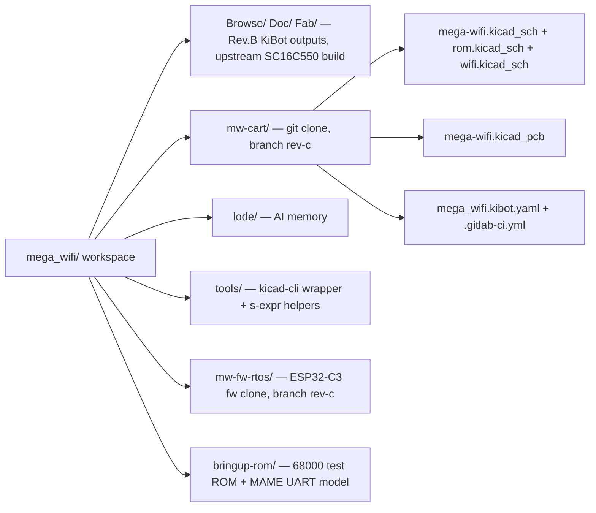

# MegaWiFi cart (mw-cart) Rev.C — project snapshot

This project is the **Rev.C fork** of doragasu's MegaWiFi Sega Mega Drive/Genesis cartridge
(CERN OHL 1.2), published at **github.com/jfryman/mw-cart** (`main`; `upstream` = GitLab).
The repo holds the KiCad sources plus `bringup-rom/`, `tools/` and this `lode/`. The firmware
fork is **github.com/jfryman/mw-fw-rtos** (`rev-c`). Order files, PDFs, the bring-up ROM and the
firmware are GitHub release assets, not in git ([plans/github-repos.md](plans/github-repos.md)). The cart has 8 MiB of flat flash ROM, an ESP32-C3-WROOM-02 Wi-Fi
module and a 16550-class parallel-to-UART bridge (U7) that lets the 68000 talk to
the ESP32. Locally the repo is `~/Desktop/mega_wifi/mw-cart/`. The workspace root
`~/Desktop/mega_wifi/` also holds the `mw-fw-rtos/` clone, `build/` outputs, and the upstream
**Rev.B KiBot outputs** (`Browse/ Doc/ Fab/`, tag `Rev.B`, commit `c749dae`; reference only, not in
git). Its `bringup-rom`, `tools` and `lode` are symlinks into the repo. `main` is upstream
`master` (`8ff38d9`, Rev.B hardware plus README edits) plus the Rev.C commits. The NXP SC16C550BIBS UART is out of stock
everywhere, so the branch replaces it with the pin-compatible **TI TL16C550DRHB**.
The TI part runs from a **20 MHz** crystal, so the cart/ESP32 link runs at
1.25 Mbaud instead of 1.5 Mbaud. That breaks existing ROMs and firmware, which is
acceptable because this board targets new ROMs. The branch is labelled **Rev.C**: title
blocks say rev C, dated 2026-10-06, company "doragasu, jfryman", and the silkscreen credit
reads "MegaWiFi Rev.C, doragasu 2024, jfryman 2026". Order files are in `build/rev-c/Fab/Manufacturers/`. Do not upload the top-level `Fab/`, which is the Rev.B build with the SC16C550 BOM.
10 assembled boards from JLCPCB arrived on 2026-10-27. Board 1 passes the full bring-up ROM (tests 1–9, incl.
the flat-8 MiB map with a Mega-CD attached) at 1.25 Mbaud; boards 2–10 are still to be checked ([plans/rev-c.md](plans/rev-c.md)). A standalone bring-up test
ROM lives in `bringup-rom/` ([firmware/bringup-rom.md](firmware/bringup-rom.md)).
The ESP32-C3 firmware fork `mw-fw-rtos` (branch `rev-c`, 1.25 Mbaud) builds in the
ESP-IDF v5.3.1 container ([firmware/uart-baud-coupling.md](firmware/uart-baud-coupling.md)).

Start with [lode-map.md](lode-map.md). The UART work is covered in
[hardware/uart-bridge.md](hardware/uart-bridge.md) and
[plans/rev-c.md](plans/rev-c.md).
